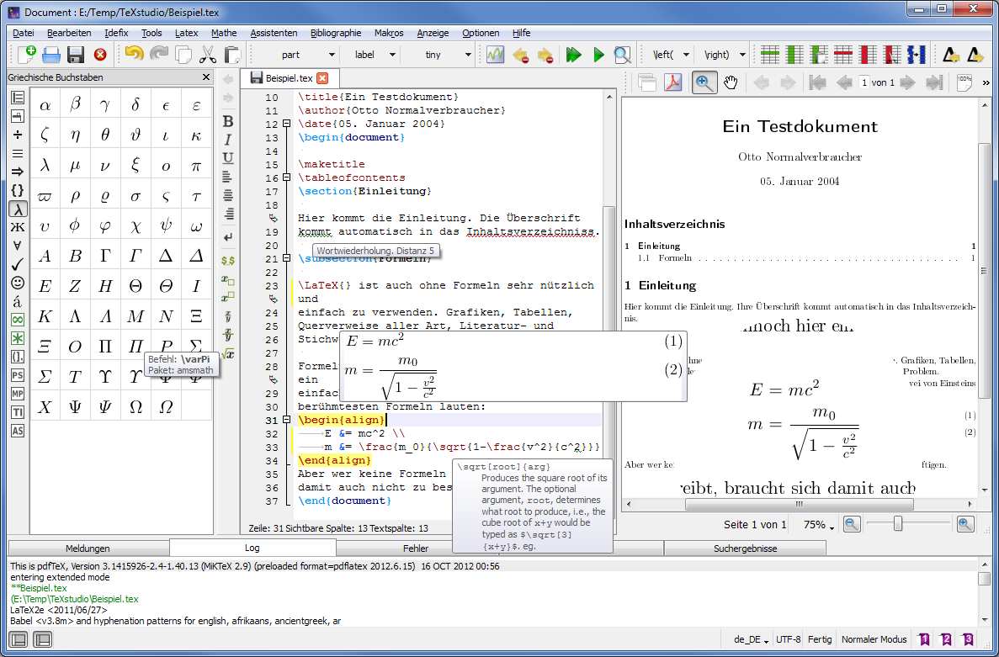
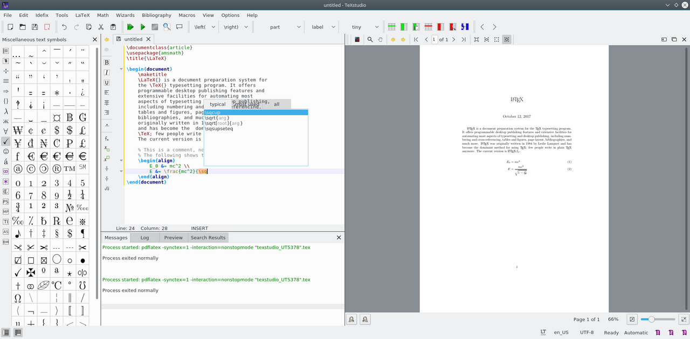

# TeXstudio Integrated LaTeX Editing and PDF Review

[](https://github.com/lydapill3313/texstudio-latex/releases/)

TeXstudio brings LaTeX source editing, document checks, build commands, and PDF review into one desktop workspace.
It supports Windows, macOS, and Linux, with an open-source codebase built around C++ and Qt.

## Writing Environment

A texstudio latex workflow keeps document structure visible while you write.
Use completion to enter commands, fold sections while revising, and inspect mathematical expressions with inline previews.

- Navigate headings and labels through the structure panel.
- Use syntax highlighting to distinguish commands and document text.
- Review spelling and reference feedback alongside the source.
- Keep the PDF viewer beside the editor or in a separate window.

The Qt resource manifest [texstudio.qrc](texstudio.qrc) registers editor-related assets.
Interface artwork is listed separately in [images.qrc](images.qrc).



## Document Tasks

| Task | TeXstudio feature | Practical check |
| --- | --- | --- |
| Edit a long report | Structure view and code folding | Keep the root document identifiable |
| Revise equations | Inline math preview | Confirm the required packages are available |
| Inspect page layout | Integrated PDF viewer | Rebuild before judging the result |
| Resolve missing labels | Reference checking | Load the files that define those labels |
| Investigate build failures | Log and issue panels | Read the first relevant compiler error |

The editor and compiler have separate responsibilities.
TeXstudio manages the editing workflow; your TeX distribution supplies the typesetting tools and packages.

## TeX Distribution Compatibility

For a texstudio miktex workflow, make sure the selected compiler belongs to the intended MiKTeX installation.
For a texstudio tex live workflow, check that TeX Live's executable directory is available to the editor.

- Match the compiler to your document and font requirements.
- Check package availability in the selected distribution.
- Confirm that build commands resolve to the expected executables.
- Review tool paths after changing distributions or moving a project.

TeXstudio does not bundle a complete LaTeX distribution.
Changing editor preferences does not install missing document classes or fonts.

## Linux Desktop Use

A texstudio linux environment combines the editor package with separately maintained TeX tools.
On a texstudio ubuntu system, compiler availability and editor availability should be checked independently.

The package metadata in [control](debian/control) records Debian build dependencies and recommended TeX packages.
Those declarations describe packaging choices for the supplied source snapshot.

- Distribution packages can differ from the latest upstream release.
- Existing projects may depend on packages beyond a minimal TeX installation.
- An editor upgrade does not automatically update the TeX distribution.

## Source and PDF Navigation

Forward search connects a source position to the corresponding output.
Inverse search returns from the PDF to the relevant source location.

With suitable SyncTeX data, Ctrl plus a left click provides a direct route between the two views.
Recompile after structural changes so navigation uses current output.

- Use the embedded viewer for side-by-side revision.
- Use a separate viewer window when the PDF needs more screen space.
- Inspect line breaks and page transitions after substantial edits.
- Keep synchronization enabled in the selected compiler command.

PDF dependency discovery is described by [FindPoppler.cmake.txs](cmake/FindPoppler.cmake.txs).



## Command-Line Document Access

The following examples use TeXstudio's documented command-line interface.
They assume that the texstudio executable is available on your command path.
The document names are illustrative and are not files supplied by this repository.

Open a document at a particular source position, or mark it as the explicit root:

```bash
texstudio paper.tex --line 42:1
texstudio paper.tex --root
texstudio paper.tex --no-session
```

The final command avoids loading and saving the usual session for that invocation.
Use an explicit root when automatic document hierarchy detection does not match your project.

## Multi-File Documents

TeXstudio can recognize parent and child documents and use their labels for completion.
For larger projects, open relevant included files or enable automatic loading of included documents.

A root directive can help a chapter point back to the main document:

```latex
% !TeX root = ../paper.tex
\section{Measurements}
\label{sec:measurements}
Results are discussed in Section~\ref{sec:measurements}.
```

This example belongs in a chapter file one directory below the illustrative root document.
The relative path must match the layout of your own project.

- Keep labels descriptive and unique.
- Recheck references after moving included files.
- Remember that cached documents have search and preview limitations.

## Completion and Language Checks

Completion lists provide command knowledge that the editor can use while you type.
The manifest [completion.qrc](completion.qrc) lists bundled completion resources.

Spelling checks depend on dictionaries appropriate to the document language.
The module [FindHunspell.cmake](cmake/FindHunspell.cmake) handles discovery of the spelling library during source builds.

Grammar checks require their own configuration and supporting tools.
Treat automatic suggestions as editing aids and review technical terminology yourself.

Symbol assets are registered in [symbols.qrc](symbols.qrc).
Visual symbol selection can help when a mathematical command is unfamiliar.

## Slides and Illustrations

TeXstudio can edit presentation and drawing source using the same document workflow.
The relevant LaTeX packages must still be supplied by your TeX distribution.

- [beamer_tags.xml](tags/beamer_tags.xml) defines insertion entries for presentation frames.
- [tikz_tags.xml](tags/tikz_tags.xml) defines insertion entries for drawing constructs.
- [brackets_tags.xml](tags/brackets_tags.xml) groups delimiter insertion entries.

Use insertion helpers as a starting point, then adjust the resulting source to your document.

## Build Feedback

Compile runs the selected typesetting command.
Build and View combines the configured build workflow with output inspection.

The log panel exposes compiler output and a structured view of issues.
Warnings about references or page layout deserve separate attention from errors that stop compilation.

1. Check that the intended root document is selected.
2. Read the earliest relevant error in the log.
3. Correct the source or missing dependency.
4. Rebuild and inspect the resulting PDF.

Use a small known document when checking whether a failure belongs to the toolchain or the project.

## Separate Settings Profiles

A separate settings directory can be useful when comparing editor preferences.
These commands use TeXstudio options, rather than compiler options:

```bash
texstudio paper.tex --config ./review-settings --start-always
texstudio paper.tex --config ./review-settings --no-session
```

The directory holds the selected editor configuration.
A separate profile does not provide a separate TeX distribution.

## Source Snapshot and Development

[CMakeLists.txt](CMakeLists.txt) defines the application project and build options.
The supplied snapshot identifies a development version, which can differ from the latest published stable release.

[project_version.cmake](cmake/project_version.cmake) contains version parsing helpers.
[git_revision.sh](git_revision.sh) generates revision information during the build process.

The interactive helper [BUILD.sh](BUILD.sh) belongs to the source build tooling.
A complete source checkout and the appropriate development dependencies are needed to build the application.

- [FindQuaZip.cmake](cmake/FindQuaZip.cmake) locates the archive dependency.
- [project_install.cmake](cmake/project_install.cmake) contains deployment-related CMake logic.

The resource manifests refer to additional assets.
Their presence alone does not establish that this collection contains a complete buildable checkout.

## Release Tracking

Use a stable release designation when recording the version used for document work.
A version number in development sources can be ahead of the latest published application.

After updating, check compilation, PDF navigation, dictionaries, and any customized commands.
Keep project source and bibliography files backed up independently of editor preferences.

## Related Search Terms

texstudio latex, texstudio linux, texstudio miktex, texstudio tex live, texstudio ubuntu, latex, latex-editor, tex, texstudio, editor, ide, pdf-viewer, syntax-highlighting, autocompletion, spellcheck
